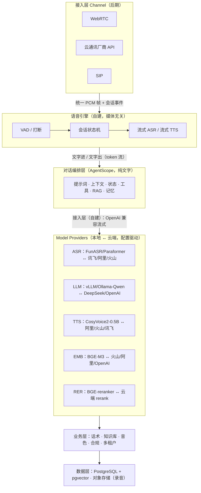
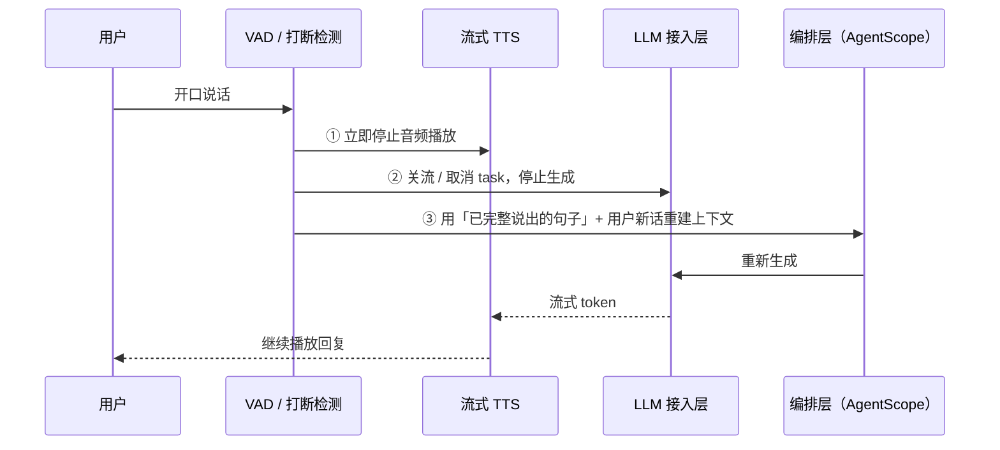
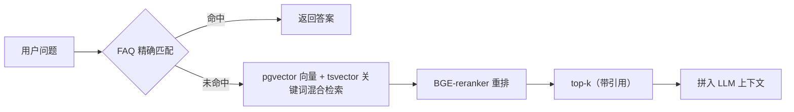
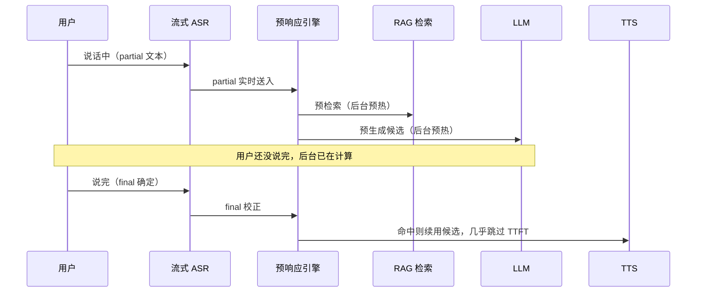

# 外呼机器人（智能体）产品需求文档（PRD）

| 项目 | 内容 |
|---|---|
| 文档版本 | v1.0 |
| 更新日期 | 2026-11-19 |
| 作者 | 产品/开发（单人） |
| 状态 | 已定稿，待开发 |
| 关联文档 | `docs/WBS.md`（工作分解与排期） |

---

## 1. 产品概述

### 1.1 背景

企业外呼场景（营销获客、逾期催收、客户回访、通知送达、客服售后）长期依赖人工坐席，成本高、效率低、质量不稳定。大模型与实时语音技术的成熟，使得「AI 外呼机器人」具备了替代/辅助人工坐席的能力。

本产品将上述能力产品化，交付一套**可对外售卖**的外呼机器人智能体平台。

### 1.2 产品定位

> 一个「音频流进 → 智能体对话 → 音频流出」的**实时流式语音对话引擎 + 话术编排平台**：
> - **场景无关**：营销 / 催收 / 回访 / 通知 / 客服通用；
> - **模型可插拔**：ASR / LLM / TTS 三个环节独立切换「本地开源模型」与「云端 API」；
> - **渠道可扩展**：先 Web/WebRTC，后期接入云通讯厂商电话通道；
> - **交付双模**：SaaS 多租户 + 私有化部署，同一套代码。

### 1.3 核心价值

1. **本地 / 云端自由切换**：客户有 GPU 就本地部署开源模型（数据不出域、成本可控、可私有化），无 GPU 就走云端 API，同一套产品覆盖两类客户。
2. **实时、可打断的自然对话**：全双工 + 打断，接近真人的抢话体验。
3. **合规内置**：录音留存、时段/频次/黑名单、话术合规审查，满足中国大陆外呼监管要求。
4. **低门槛话术配置**：可视化流程编排 + Prompt + 行业模板库，非技术人员也能快速上线。

### 1.4 目标用户

| 用户 | 诉求 |
|---|---|
| 企业业务方（金融/保险/房产/教育/电商/银行） | 降低外呼成本，提升触达效率 |
| 话术运营/客服主管 | 快速配置与迭代话术流程 |
| 系统集成商 | 通过 SDK/API 集成到自有业务系统 |
| 私有化部署客户 | 数据不出域、自主可控 |

---

## 2. 需求基线（已确认决策）

| 维度 | 定案 |
|---|---|
| 产品内核 | 媒体无关的实时流式语音对话引擎 |
| 场景 | 通用：营销 / 催收 / 回访 / 通知 / 客服 |
| 售卖模式 | SaaS 多租户 + 私有化 license（同一套代码） |
| 目标市场 | 中国大陆（合规为刚需） |
| 呼叫通道 | 先不打真电话；Web/WebRTC 流式进出；后期接云通讯厂商 API |
| 对话模式 | 全双工 + 打断（P1 先半双工，P2 上全双工） |
| 模型切换 | ASR / LLM / TTS 三环节**独立**切换本地↔云端 |
| 交付形态 | Web 网页 + API/SDK + 桌面/移动 App（后期） |
| 技术栈 | Python |
| Web 音频 | WebRTC |
| 数据库 | PostgreSQL 16 + pgvector（Docker Compose，WSL Ubuntu） |
| LLM 编排 | AgentScope（文字进出）；语音引擎 + 接入层自建 |
| 并发规模 | 起步 ≤ 几十路，架构留扩展 |
| 开发期模型 | LLM 云端 DeepSeek；ASR 本地 FunASR(Paraformer 流式)；TTS 本地 CosyVoice2-0.5B |
| 资源 | 单人开发，无时间限制 |

---

## 3. 产品功能需求

### 3.1 P0 —— 内核（MVP 必须跑通）

#### 3.1.1 流式语音管线

**描述**：音频帧进 → 流式 ASR → 流式 LLM → 流式 TTS → 音频帧出，三段异步解耦。

**需求点**：
- 支持 8k / 16k / 24k 采样率音频帧输入，统一重采样；
- ASR 流式出「中间结果 + 最终结果」；
- LLM 流式吐 token，**首 token 即触发 TTS 流式合成**（降低停顿感）；
- TTS 分块合成，边生成边播放。

**验收标准**：
- 端到端（用户说完 → 听到机器人首个字）延迟目标 < 1s（本地模型可更优，需实测）；
- 三段流水线互不阻塞。

#### 3.1.2 全双工 + 打断

**描述**：VAD 检测用户开口，立即停止机器人说话，支持抢话。

**需求点**：
- VAD（Silero-VAD）检测语音起音/端点；
- 打断触发时：**立即停止 TTS 音频播放** + **接入层关流停止 LLM 生成**；
- 上下文重建：机器人「已完整说出的句子」保留，被打断的半句丢弃，加上用户新话重新生成；
- 打断灵敏度可配置（避免噪声误打断）。

**验收标准**：
- 打断响应（用户开口 → 音频停止）目标 < 150ms；
- 打断后对话连贯、不重复、不丢失关键上下文。

#### 3.1.3 三环节模型切换（配置驱动）

**描述**：ASR / LLM / TTS 各自可配置为「本地开源」或「云端 API」，运行时可切。

**需求点**：
- 统一 Provider 抽象接口（ASR / LLM / TTS 各一个），本地与云端为不同实现；
- LLM 统一走 OpenAI 兼容接口（DeepSeek / vLLM / Ollama 均为 OpenAI 兼容，切换即换 `base_url + api_key + model`）；
- 配置放入配置文件，**Web 后台可改**。

**验收标准**：
- 不改代码，仅改配置即可完成三环节各自的本地↔云端切换；
- 切换后对话链路正常、延迟指标可观测。

#### 3.1.4 Web 演示客户端

**描述**：浏览器麦克风 + 扬声器，WebRTC 全双工，对话 UI。

**需求点**：
- 麦克风采集 / 扬声器播放（浏览器自带回声消除 AEC）；
- 实时转写展示（用户 + 机器人）；
- 音色 / 模型配置面板。

**验收标准**：
- 浏览器内可完成一次完整对话，体验自然。

### 3.2 P1 —— 产品化（打磨期）

#### 3.2.1 话术流程编排

**描述**：多场景通用的话术/对话逻辑配置。

**需求点**：
- **可视化流程编排**：节点/状态机/分支（开场白 → 主问答 → 意图分支 → 跳转 → 结束语）；
- **Prompt 模板**：系统人设、约束、合规边界；
- **变量插槽**：客户姓名、订单号、金额等动态填充；
- **行业模板库**：营销 / 催收 / 回访 / 通知 / 客服 预置模板。

**验收标准**：
- 非技术人员通过拖拽 + 改模板，可配置出可用的外呼话术；
- 话术可灰度发布、可回滚。

#### 3.2.2 知识库（FAQ + RAG）

**描述**：客服 / 银行等场景，检索知识回复长尾问题。

**需求点**：
- **文档导入**：PDF / Word / Excel / 网页 / FAQ 表格；
- **RAG 管线**：解析清洗 → 分块 → Embedding(BGE-M3) → pgvector 入库；
- **混合检索**：FAQ 精确匹配优先 → pgvector 向量 + tsvector 关键词混合检索 → BGE-reranker 重排 → top-k(带引用)；
- **金融安全**：无据则拒答并转人工，答案必须可溯源（文档+段落）。

**验收标准**：
- 检索延迟 < 100ms 级，不拖慢流式对话；
- 回复带引用来源，可回溯审计。

#### 3.2.3 音色管理

**描述**：满足营销/催收等不同场景的音色需求。

**需求点**：
- **预设音色库**：多种风格可选；
- **声音克隆**：CosyVoice2 零样本克隆（3 秒素材），注意声音肖像权合规；
- **情感/风格控制**：语速、停顿、情绪（亲切/严肃等）可指令控制。

**验收标准**：
- 音色可切换、可预览、可绑定到具体话术。

#### 3.2.4 合规套件

**描述**：中国大陆外呼合规刚需。

**需求点**：
- **录音留存与回放**：全程录音、按监管时长留存、可调听；
- **时段/频次/黑名单控制**：外呼时段限制、频次控制、号码黑/白名单；
- **话术合规审查**：敏感词 + 违规话术实时拦截与告警。

**验收标准**：
- 录音完整、可回放、留存时长可配；
- 命中黑名单/时段外/频次超限时，自动拦截不外呼；
- 违规话术实时拦截并留痕。

#### 3.2.5 管理后台

**描述**：运营管理界面。

**需求点**：租户/话术/音色/模型配置/任务/会话/知识库管理。

**验收标准**：上述资源均可在后台 CRUD，状态可见。

### 3.3 P2 —— 售卖化（售卖期）

| 模块 | 需求点 |
|---|---|
| 多租户 SaaS | 租户隔离、按路数/分钟计费、配额管理 |
| 私有化交付 | Docker Compose / Helm 一键部署包、License 授权 |
| 渠道接入 | 云通讯厂商 API（阿里/腾讯/容联/声网/Twilio）、SIP 中继 |
| SDK/API | 供客户应用集成；桌面/移动 App |
| 可观测 | 实时路数、延迟指标（ASR/TTFT/TTS 首包）、通话质检、账单 |

---

## 4. 非功能需求

### 4.1 性能与延迟

| 指标 | 目标值（需实测调优） |
|---|---|
| ASR 首字延迟（partial） | < 300ms |
| 语音响应（用户说完 → TTS 首包） | < 1s |
| 打断响应（开口 → 音频停止） | < 150ms |
| TTS 首包延迟 | < 300ms |
| 全链路 RTF | < 1 |
| 单机并发 | 起步 ≤ 几十路，可扩展 |

### 4.2 合规与安全

- 符合中国大陆外呼相关监管（工信部实名、骚扰电话治理、频次/时段限制）；
- 录音与转写数据加密存储、访问审计；
- 私有化场景数据不出客户机房。

### 4.3 可扩展性

- 核心引擎与通道解耦（媒体无关），新增通道不改内核；
- 模型 Provider 可插拔，新增厂商不改调用方；
- SaaS 多租户与私有化单租户共用一套代码（配置驱动）。

### 4.4 可维护性

- 分层清晰、模块解耦（语音引擎 / 编排层 / 接入层 / Provider 层）；
- 关键链路全程可观测（日志、指标、链路追踪）。

---

## 5. 技术架构（概要）

### 5.1 关键机制

**全双工打断**：

**三环节切换**：ASR/LLM/TTS/Embedding/Rerank 各一个 `provider_config`，本地/云端只是换 `base_url / key / model`（OpenAI 兼容全家桶）。

**知识库检索**：

### 5.2 延迟优化设计

延迟是本产品的命门，核心战场在 **TTFT（首 token）**。设计三原则：**让输入更短、让输入更可复用、让计算提前发生**。

**（1）感知点与延迟预算**

| 感知点 | 定义 | 目标 | 主要瓶颈 |
|---|---|---|---|
| TTFT（首 token） | 用户说完 → 机器人开始生成 | < 500ms（命中缓存 < 300ms） | LLM 预填充 + RAG 检索 |
| TTS 首包 | LLM 吐字 → 听到声音 | < 300ms | TTS |
| 打断响应 | 用户开口 → 音频停止 | < 150ms | VAD |

端到端（用户说完 → 听到首个字）：目标 **< 1s**；「边说边想」上线后 **< 400ms**。

**（2）LLM 侧优化**

- **MVP 就做**：
  - 首 token 即合成（不等整句）；
  - 精简 + 稳定 Prompt 前缀：系统人设/工具定义/合规边界放前面，变化内容放后面，利用 DeepSeek 上下文缓存 / vLLM prefix caching 复用 KV cache；
  - 上下文窗口管控：滑窗 + 摘要压缩，控制历史长度；
  - 限制生成长度：外呼单轮回复短，`max_tokens` 设 128~256。
- **后期**：边说边想预响应；本地推理加速（vLLM 量化 AWQ/GPTQ、投机解码）；分级降级（TTFT 超阈值自动切小模型/减上下文）。

**（3）RAG 侧优化**

- FAQ 精确匹配优先：毫秒级命中，跳过向量检索与 rerank；
- 向量检索：pgvector HNSW + 小 top-k（召回 20~50）+ 向量量化（halfvec）；
- rerank（延迟大头）：只对召回 top-N 计算、高置信度跳过、用 bge-reranker-lite；
- 检索缓存 + 说话中预检索（配合边说边想）；
- 分块小（200~500 token）+ 只拼 top-3 精炼片段 + 引用。

**（4）「边说边想」预响应流水线**

要点：每出一个 partial 就触发一次轻量预检索/预生成，final 确认后**命中续用、不命中作废重来**（作废代价可控）；最终用户感知的「思考时间」≈ TTS 首包。

**（5）落地节奏**

| 阶段 | 动作 |
|---|---|
| P1~P3 | 首 token 即合成、稳定前缀+缓存、上下文管控、FAQ 优先、HNSW+小 top-k、rerank 仅算召回集 |
| P4~P6 | 检索缓存+预取、边说边想预响应流水线 |
| P8 | 分级降级、本地推理加速调优 |

---

## 6. 数据模型（初版）

| 表 | 说明 |
|---|---|
| `tenant` | 租户 |
| `agent` | 话术/机器人配置 |
| `flow` | 话术流程节点 |
| `kb` / `kb_chunk` | 知识库 / 知识分块（含向量） |
| `session` | 通话会话 |
| `turn` | 对话轮次 |
| `recording` | 录音（含转写对齐） |
| `voice` | 音色 |
| `provider_config` | 模型提供方配置（base_url/key/model） |
| `blacklist` | 号码黑/白名单 |
| `compliance_rule` | 合规规则（时段/频次/敏感词） |

---

## 7. 版本规划与里程碑

| 阶段 | 目标 | 里程碑交付物 |
|---|---|---|
| P1 | 单链路半双工跑通 | 可对话的 Web Demo |
| P2 | 全双工 + 打断 | 自然抢话体验 |
| P3 | 三环节切换 + Web 配置 | 切换卖点落地 |
| P4 | Web UI 打磨 | 可对外演示 |
| P5 | 话术引擎 | 场景可配置 |
| P6 | 知识库 | FAQ + RAG 上线 |
| P7 | 合规 | 合规闭环 |
| P8 | 售卖化 | 可售卖产品 |

> 详细任务分解与排期见 `docs/WBS.md`。

---

## 8. 风险与假设

| 风险 | 影响 | 应对 |
|---|---|---|
| 全双工打断体验不达标 | 核心卖点受损 | P2 单独攻坚，打断灵敏度可配，充分调优 |
| 本地 TTS 并发瓶颈 | 几十路并发受限 | 多卡/多实例，或切云端 TTS |
| 语音延迟超目标 | 体验差 | 流式衔接 + 首 token 即合成 + 实测调优 |
| 合规政策变动 | 售卖风险 | 合规规则配置化，快速适配 |
| 声音克隆肖像权 | 法律风险 | 内置授权确认流程，谨慎开放 |

**假设**：
- 单人全职开发，无外部时间压力；
- 开发机为 RTX 4060 8GB，可本地跑 ASR/TTS 推理；
- 本地 Docker 环境（WSL Ubuntu）可用。
