# callbot 架构图集（Mermaid）

> 用 mermaid 语法渲染的项目架构、流程与业务结构图。
> 用途：架构评审、技术答辩 PPT、简历附录、团队培训。
> 渲染方式：Typora / VS Code（Markdown Preview Mermaid Support）/ GitHub 直接预览。

---

## 1. 系统分层架构

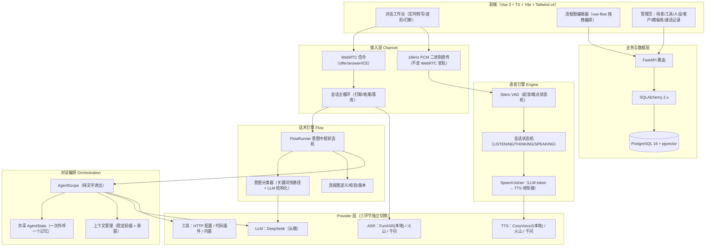

---

## 2. 部署拓扑

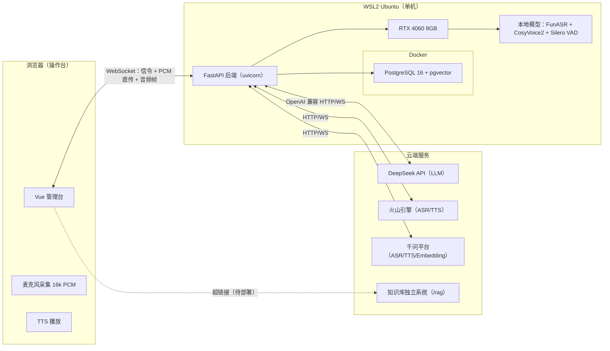

---

## 3. 一次通话完整生命周期（时序）

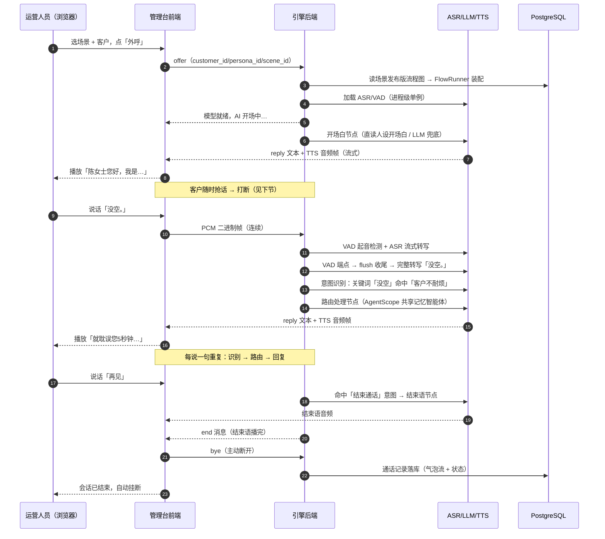

---

## 4. 打断五步动作链（时序）

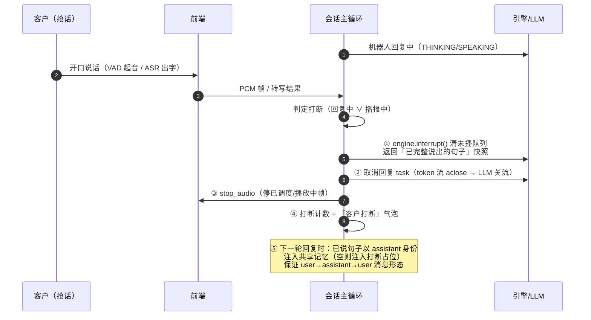

---

## 5. 意图中枢状态机（每轮对话）

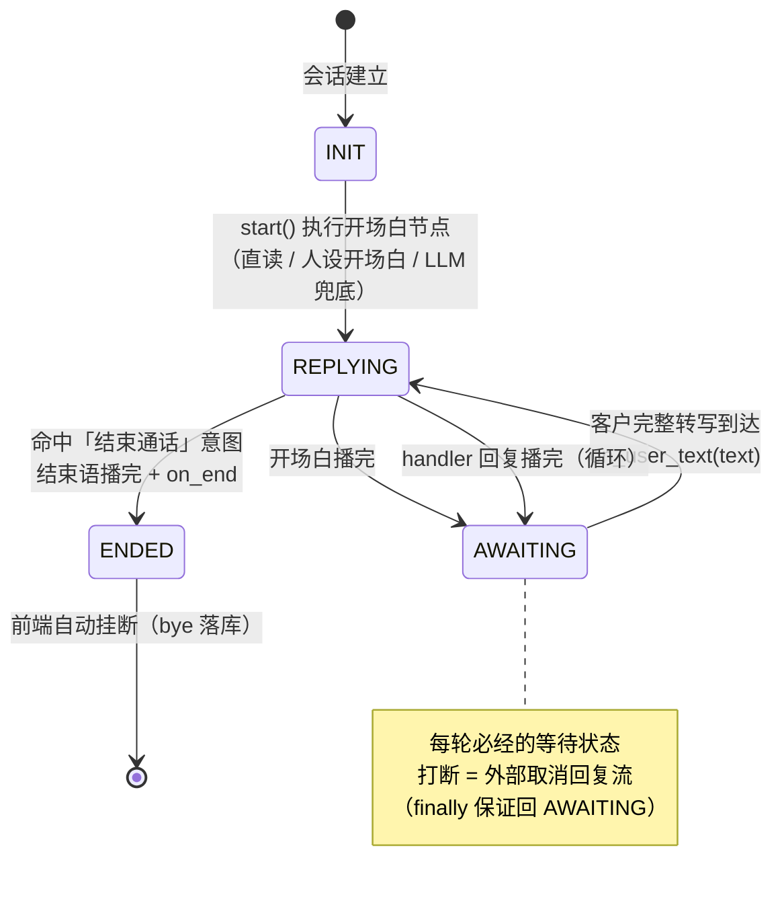

---

## 6. 每轮「识别 → 路由 → 回复」处理流程

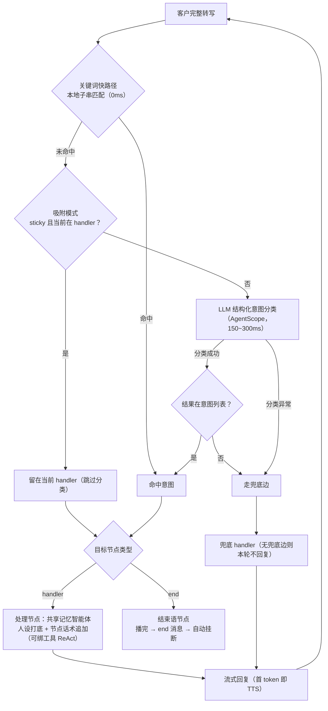

---

## 7. 业务资产模型（场景为核心）

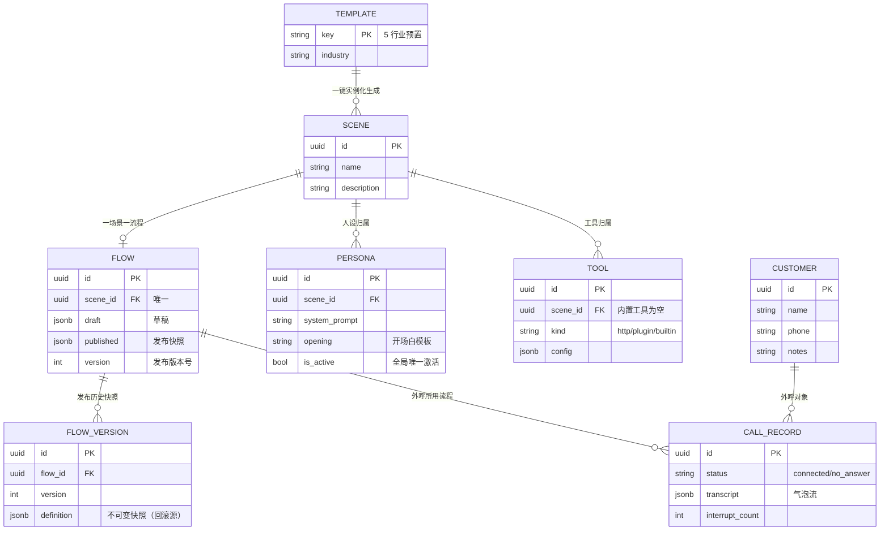

---

## 8. 流程发布 / 回滚机制

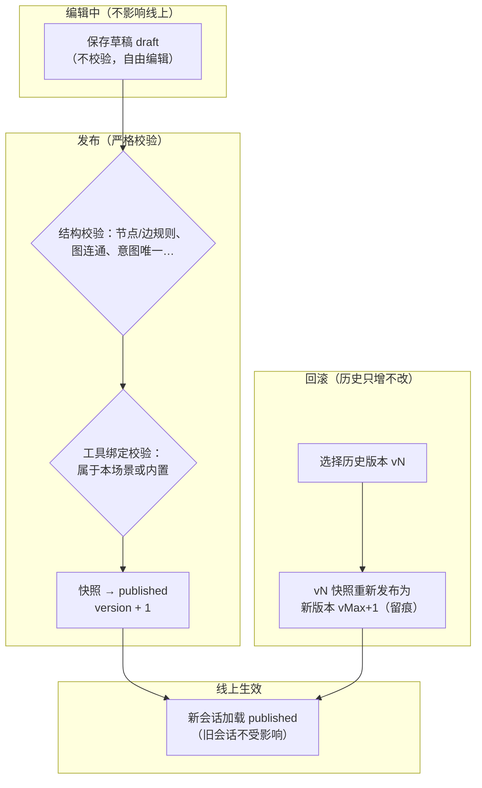

---

## 9. 工具三轨体系

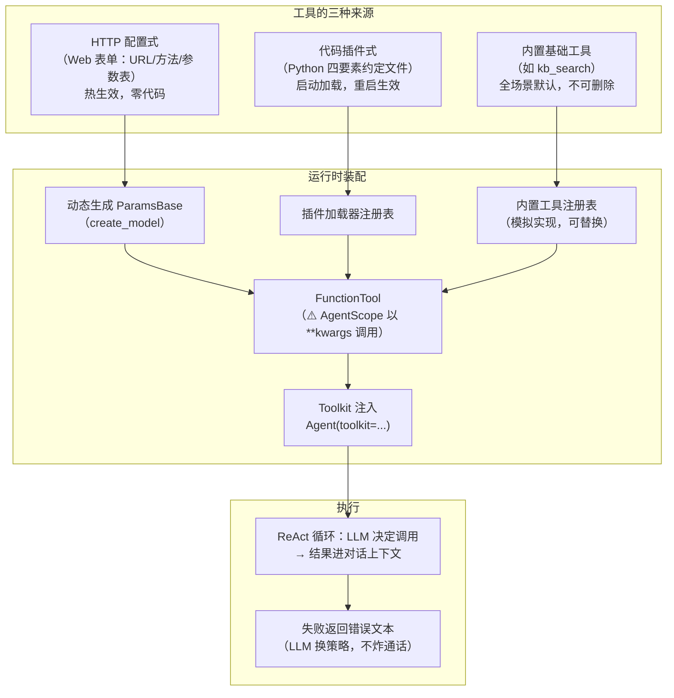

---

## 10. 三环节 Provider 配置驱动切换

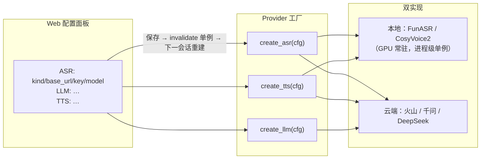

---

## 11. 开场白三选一（开场白节点语义）

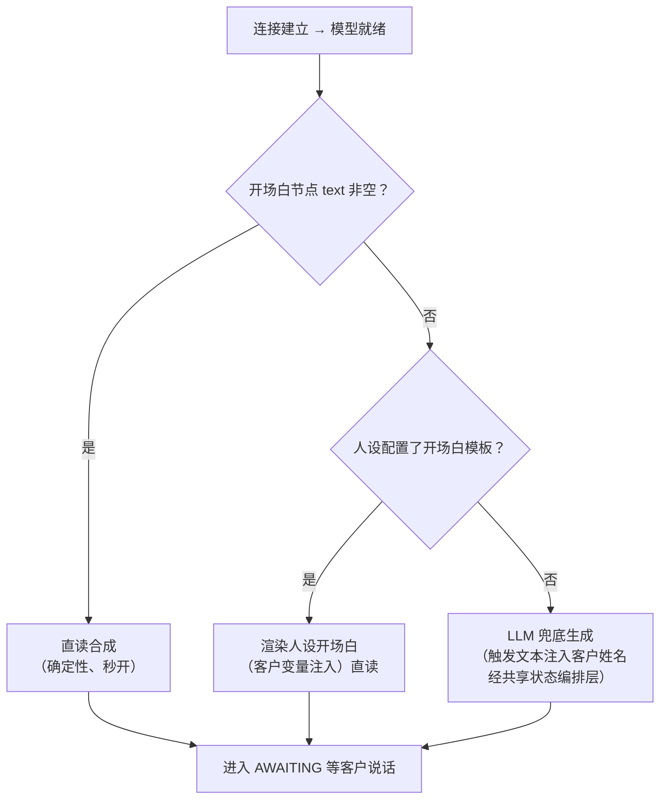

---

## 12. 通话记录状态判定

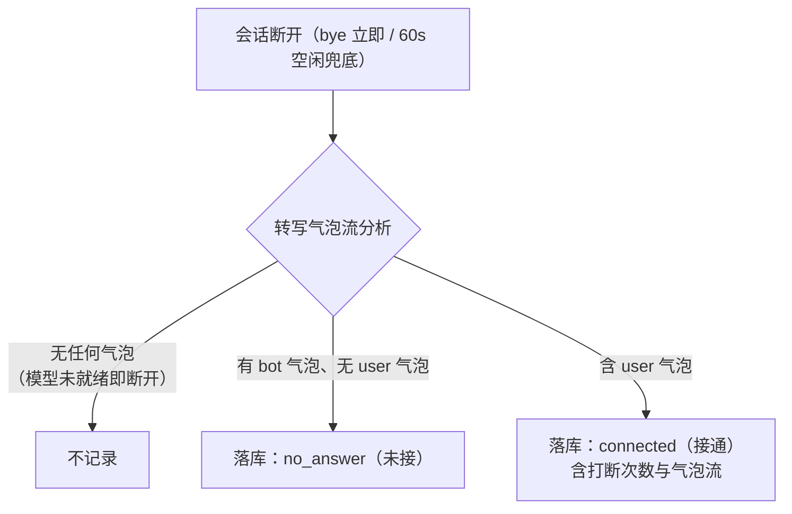
